# Formica

[English](README.md) · **Italiano**

[](LICENSE)


[](#autorizzazioni)

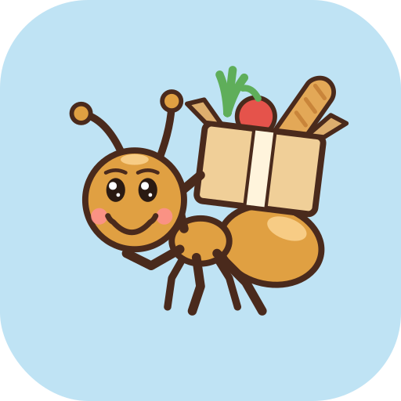

**Formica** è un'app Android per gestire la **dispensa di casa** e la **lista della
spesa**: cosa c'è, dove si trova, quando scade e cosa ricomprare. Pensa anche ai prodotti
fatti in casa e a quelli comprati dai produttori. Si condivide in famiglia scambiando un
file tra i telefoni, e funziona senza internet, senza account e senza server.

**Il nome.** *Formica* è latino, come in italiano: le formiche sono tra gli esseri
viventi che fanno le migliori dispense.

È software libero, senza accesso a internet, senza pubblicità e senza tracker, e usa
solo librerie open source (AndroidX, Kotlin). Le release sono compilate, firmate e
verificate da GitHub Actions, e le build sono pensate per essere riproducibili.

<p align="center">
  <a href="https://apps.obtainium.imranr.dev/redirect?r=obtainium://add/https://github.com/nidamanx/formica"></a>
  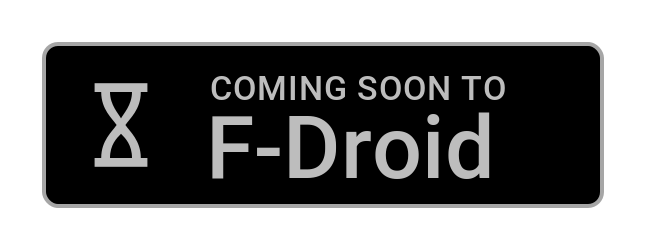
  <a href="https://github.com/nidamanx/formica/releases/latest">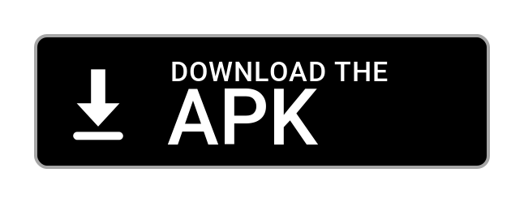</a>
</p>

Certificato di firma, da controllare con [AppVerifier](https://github.com/soupslurpr/AppVerifier)
o [Obtainium](https://github.com/ImranR98/Obtainium) ([altre verifiche](#verifica)):

```
io.github.nidamanx.formica
5A:73:FC:B9:DB:E5:53:D0:F7:18:7F:56:04:90:4C:EC:19:DD:77:6B:AB:1B:0A:C2:8D:17:69:1D:88:B6:B3:9C
```

<p align="center">
  <a href="fastlane/metadata/android/it-IT/images/phoneScreenshots/1.png">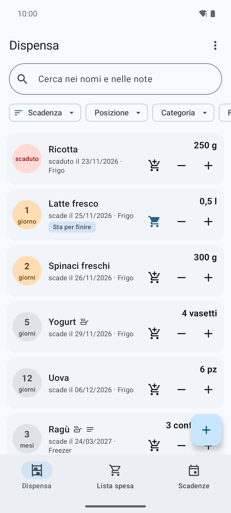</a>
  <a href="fastlane/metadata/android/it-IT/images/phoneScreenshots/2.png">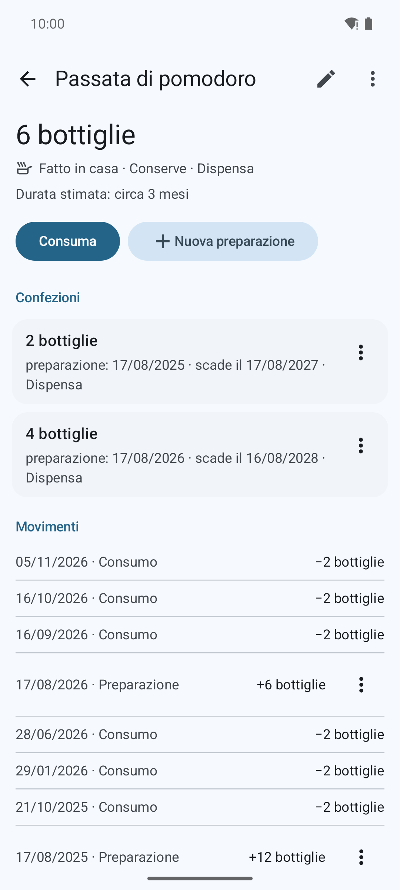</a>
  <a href="fastlane/metadata/android/it-IT/images/phoneScreenshots/3.png">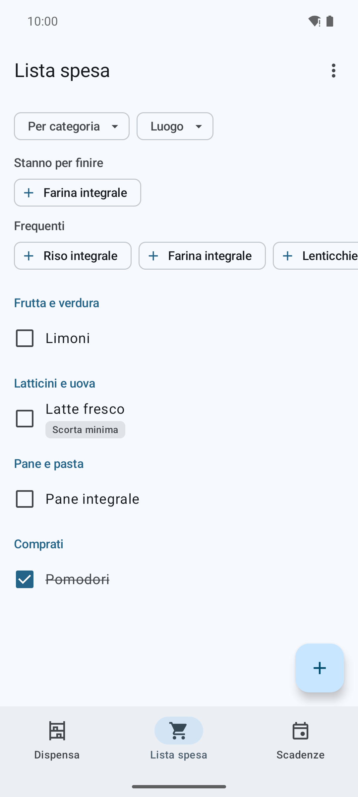</a>
  <a href="fastlane/metadata/android/it-IT/images/phoneScreenshots/4.png">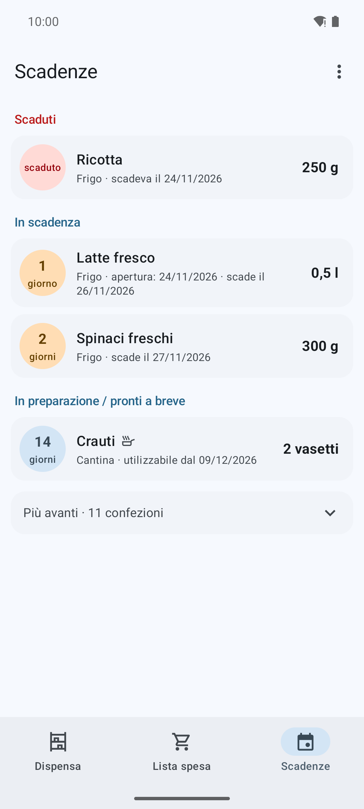</a>
</p>
<p align="center">
  <a href="fastlane/metadata/android/it-IT/images/phoneScreenshots/5.png">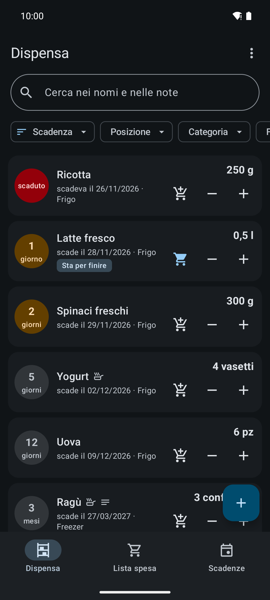</a>
  <a href="fastlane/metadata/android/it-IT/images/phoneScreenshots/6.png">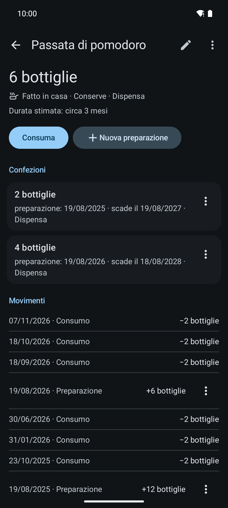</a>
  <a href="fastlane/metadata/android/it-IT/images/phoneScreenshots/7.png">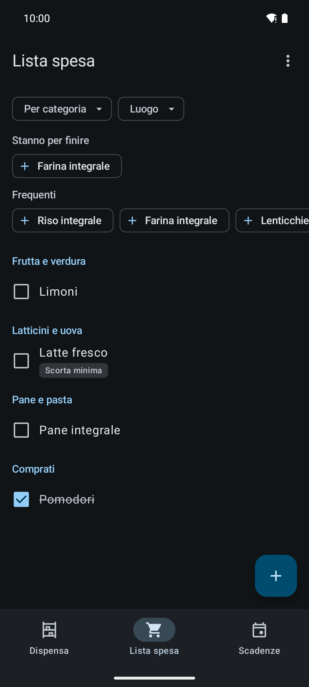</a>
  <a href="fastlane/metadata/android/it-IT/images/phoneScreenshots/8.png">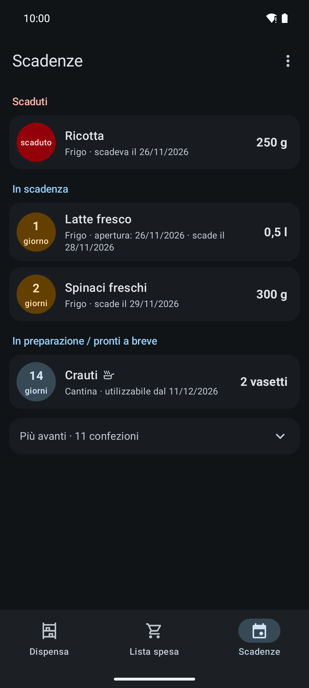</a>
</p>

## Perché

In casa la dispensa la gestiscono in più persone: chi fa la spesa non sa cosa è appena
finito, il latte si compra due volte, il barattolo in fondo al frigo scade senza che
nessuno se ne accorga. Le app che risolvono il problema di solito chiedono un account,
mettono i dati su un server e mostrano pubblicità.

Con Formica i dati restano sul telefono e si condividono in famiglia con un file, mandato
per esempio in una chat. Le modifiche fatte su più telefoni si uniscono senza un server.

---

## Indice

- [Funzioni](#funzioni)
- [Requisiti](#requisiti)
- [Installazione](#installazione)
  - [Aggiornamento](#aggiornamento)
  - [Verifica](#verifica)
- [Uso](#uso)
- [In famiglia](#in-famiglia)
- [Autorizzazioni](#autorizzazioni)
- [Privacy](#privacy)
- [Limiti noti](#limiti-noti)
- [Compilare dal sorgente](#compilare-dal-sorgente)
- [Traduzioni](#traduzioni)
- [Struttura del progetto](#struttura-del-progetto)
- [Versioni](#versioni)
- [Licenza ed esclusione di responsabilità](#licenza-ed-esclusione-di-responsabilità)

---

## Funzioni

- **Dispensa**: prodotti con quantità anche decimali, unità, categoria, posizione (frigo,
  freezer, dispensa, cantina e altre a scelta) e note. Ricerca nei nomi e nelle note,
  filtri e ordinamento per scadenza, nome o data di preparazione.
- **Confezioni e scadenze**: più confezioni dello stesso prodotto con scadenze diverse;
  «aperto il», con i giorni di validità dopo l'apertura; si consuma prima quella che
  scade prima.
- **Fatto in casa e dai produttori**: conserve, yogurt, fermentati e molto altro, con la
  data di preparazione e il giorno da cui sono pronti; acquisti in grandi quantità.
- **Stima della durata**: dai consumi delle ultime settimane, quanto dureranno le scorte.
- **Lista della spesa**: voci collegate alla dispensa o libere, raggruppate per
  categoria o per negozio. La scorta minima mette in lista un prodotto quando scende
  sotto la quantità scelta; in alto i prodotti che stanno per finire e quelli comprati
  spesso.
- **Dove conviene**: per ogni prodotto, il negozio e il prezzo migliore, annotati a mano.
- **Una notifica al giorno**, all'ora scelta, con quello che scade e quello che è pronto;
  nessuna se non c'è niente da segnalare.
- **In famiglia**: esporta un file e aprilo su un altro telefono, con anteprima, copia di
  sicurezza e annullamento (vedi [In famiglia](#in-famiglia)).
- **Accessibile**: funziona con TalkBack e con i caratteri grandi; tema chiaro e scuro
  secondo il sistema.
- English, Italiano, Français, Deutsch, Español.

## Requisiti

- Android 8.0 (API 26) o successivo, su **telefoni e tablet**: con o senza i servizi
  Google, con il sistema originale del produttore o con sistemi alternativi come
  GrapheneOS, LineageOS e molti altri.

## Installazione

**[Obtainium](https://github.com/ImranR98/Obtainium)** (aggiornamenti direttamente
dalle release di GitHub): aggiungi l'app con questo indirizzo

```
https://github.com/nidamanx/formica
```

**F-Droid**: in arrivo.

**A mano**: scarica `formica-<versione>.apk` dall'[ultima
release](https://github.com/nidamanx/formica/releases/latest) e aprilo sul telefono.

### Aggiornamento

Obtainium e F-Droid avvisano delle nuove versioni. Un'installazione fatta a mano si
aggiorna installando l'APK della nuova release sopra la vecchia: i dati restano. Ogni
versione è firmata con la stessa chiave (vedi [Verifica](#verifica)).

### Verifica

Ogni release è compilata da GitHub Actions a partire dal codice sorgente marcato con il
suo tag. Ci sono tre verifiche indipendenti.

**1. Certificato di firma.** È lo stesso per ogni versione. Confrontalo con
[AppVerifier](https://github.com/soupslurpr/AppVerifier) o con
[Obtainium](https://github.com/ImranR98/Obtainium).

```
io.github.nidamanx.formica
5A:73:FC:B9:DB:E5:53:D0:F7:18:7F:56:04:90:4C:EC:19:DD:77:6B:AB:1B:0A:C2:8D:17:69:1D:88:B6:B3:9C
```

**2. Checksum del file.** Ogni release contiene `SHA256SUMS`:

```
sha256sum -c SHA256SUMS
```

**3. Provenienza della build.** Un'attestazione firmata dimostra che l'APK è stato
prodotto dal workflow di release di questo repository a partire da un commit preciso:

```
gh attestation verify formica-<versione>.apk --repo nidamanx/formica
```

Le build sono pensate per essere riproducibili: F-Droid compila l'app dal sorgente sui
propri server e la distribuisce solo se il risultato è identico all'APK pubblicato qui.

Per segnalare un problema di sicurezza, vedi [SECURITY.md](SECURITY.md).

## Uso

1. Al primo avvio scegli il nome del telefono (lo vedono gli altri telefoni della
   famiglia) e se ricevere la notifica giornaliera. Posizioni e categorie sono già
   pronte; si cambiano nelle Impostazioni.
2. Nella **Dispensa** tocca **+** per aggiungere un prodotto: nome, quantità, unità,
   scadenza. I campi in più (durata, scorta minima, dove conviene…) sono facoltativi.
3. Sulla scheda di un prodotto: **−** per consumarne un po', **+** per un nuovo acquisto
   o una nuova preparazione, il carrello per metterlo in lista. Tocca la scheda per i
   dettagli: confezioni (se ne possono cambiare date e negozio), spostamenti, apertura,
   storico (lì si annulla un acquisto o una preparazione inseriti per errore).
4. Nella **Lista della spesa** spunta quello che compri: Formica chiede se aggiungerlo
   alla dispensa.
5. In **Scadenze** trovi cosa è scaduto, cosa scade a breve e cosa sta per essere pronto.

## In famiglia

Ogni telefono ha i suoi dati. Per metterli in comune, su un telefono apri
**Impostazioni → Scambio dati → Esporta** e manda il file all'altro telefono (in una
chat, per email, con un cavo…); sull'altro apri il file con Formica.

- Un'**anteprima** mostra cosa cambierà prima di toccare i dati.
- Tre modalità: **Unisci** (tiene le modifiche di tutti e due i telefoni), **Solo nuovi
  prodotti**, **Sostituisci tutto**.
- Le modifiche fatte su più telefoni si uniscono: le quantità sono la somma di acquisti e
  consumi, i doppioni con lo stesso nome vengono proposti per l'unione, le note scritte
  da tutti e due restano una sotto l'altra.
- Prima di ogni importazione Formica salva una **copia dei dati** (le ultime 5), e
  l'ultima importazione si può **annullare**.
- Le copie restano nella memoria dell'app su questo telefono: disinstallando Formica si
  cancellano. Per un backup altrove esporta il file con **Salva in…** (in una cartella o
  in un'app di archiviazione, come Nextcloud e molte altre); per recuperarlo, aprilo con
  Formica e scegli **Sostituisci tutto**.

Per tenere allineati i telefoni basta scambiarsi il file ogni tanto, nei due sensi.

## Autorizzazioni

Formica **non ha accesso a internet** e chiede solo queste autorizzazioni:

| Autorizzazione | Perché |
|---|---|
| Notifiche (`POST_NOTIFICATIONS`) | La notifica giornaliera delle scadenze e delle preparazioni pronte. Da Android 13 viene chiesta, e si può rifiutare |
| Avvio all'accensione (`RECEIVE_BOOT_COMPLETED`) | Ripianificare la notifica dopo il riavvio del telefono. Aggiunta da WorkManager, la libreria Android che la pianifica |
| Impedire la sospensione (`WAKE_LOCK`) | Solo durante il controllo giornaliero, una volta al giorno; non accende lo schermo. Aggiunta da WorkManager |
| Autorizzazione interna di Formica (`io.github.nidamanx.formica.DYNAMIC_RECEIVER_NOT_EXPORTED_PERMISSION`) | Impedisce ad altre app di mandare messaggi alle parti interne di Formica e non dà accesso a nessun dato. Serve fino ad Android 12; dalle versioni successive Android offre la stessa protezione da sé e l'autorizzazione resta inutilizzata. Nessun'altra app può ottenerla |

Ogni build fallisce da sola se l'APK chiede qualcos'altro
(vedi `config/allowed-permissions.txt`).

## Privacy

Formica non raccoglie niente, non manda niente e non contiene pubblicità né statistiche
d'uso. I dati restano sul telefono e sono **esclusi dai backup di Android** e dal
trasferimento a un nuovo telefono: escono solo con l'esportazione che avvii tu. Vedi
[PRIVACY.md](PRIVACY.md).

Il file esportato è un normale file JSON, non cifrato: chi lo riceve può leggerne il
contenuto. Mandalo solo a chi vuoi.

Formica **non ha accesso** a posizione, contatti, fotocamera, microfono o altri dati
personali. Puoi verificarlo: il sorgente è pubblico, e la build fallisce se l'app chiede
un'altra autorizzazione.

## Limiti noti

- Lo scambio è manuale: i telefoni non si sincronizzano da soli.
- I prezzi di «Dove conviene» sono in euro.
- Un nuovo acquisto con la stessa scadenza e posizione di una confezione già in dispensa,
  non ancora aperta, si aggiunge a quella, che conserva data e negozio del primo acquisto.
- La notifica giornaliera può arrivare con qualche minuto di ritardo: Android raggruppa
  i lavori in background per risparmiare batteria.
- Su tablet l'interfaccia è quella del telefono, allargata a tutto lo schermo.

## Compilare dal sorgente

Servono JDK 17 e l'Android SDK.

```
./gradlew test lintRelease assembleRelease
```

Il risultato è un APK non firmato in `app/build/outputs/apk/release/`. Dettagli per chi
mantiene il progetto in [docs/MAINTAINING.md](docs/MAINTAINING.md).

## Traduzioni

I testi dell'app sono in `app/src/main/res/values-*/strings.xml`, quelli degli store in
`fastlane/metadata/android/*/`. Le correzioni sono benvenute.

## Struttura del progetto

```
formica/
├── app/        l'app (Kotlin, Jetpack Compose, Room) e i suoi test
├── art/        icona, banner degli store, immagine social e badge di installazione
├── config/     le sole autorizzazioni che l'APK può chiedere
├── docs/       note per chi mantiene il progetto
├── fastlane/   testi e screenshot degli store per lingua, changelog in inglese
├── fdroid/     bozza della ricetta di build per F-Droid
├── keystore/   impronte dei certificati di firma
├── scripts/    script usati dai controlli automatici
└── .github/    workflow di GitHub Actions
```

## Versioni

Il progetto segue il [Semantic Versioning](https://semver.org/lang/it/). La versione
(`versionName`, e `versionCode` per Android) è in `app/build.gradle.kts` e si vede in
Informazioni, nel menu ⋮. Ogni release ha un tag Git `vX.Y.Z`, e le modifiche di ogni
versione sono elencate in [CHANGELOG.md](CHANGELOG.md).

## Licenza ed esclusione di responsabilità

Copyright (C) 2026 Nicola Davide Mannarelli ([@nidamanx](https://github.com/nidamanx))

Questo programma è software libero: puoi redistribuirlo e/o modificarlo secondo i
termini della **GNU Affero General Public License** pubblicata dalla Free Software
Foundation, versione 3 o (a tua scelta) qualsiasi versione successiva
(`SPDX-License-Identifier: AGPL-3.0-or-later`). Vedi il file [LICENSE](LICENSE).

Alcune icone vengono da [Material Symbols](https://github.com/google/material-design-icons)
di Google, con licenza Apache 2.0.

**Citazione.** Se usi questa app, o parti del suo codice, nel tuo lavoro o in un altro
progetto, cita *Formica* di Nicola Davide Mannarelli con un link a questo repository.
Il pulsante **Cite this repository** di GitHub, generato da
[CITATION.cff](CITATION.cff), fornisce una citazione pronta. La licenza già richiede che
le copie redistribuite e modificate mantengano la nota di copyright.

**Esclusione di responsabilità.** Questo software è fornito «così com'è», senza garanzie
di alcun tipo, esplicite o implicite. In nessun caso l'autore è responsabile di danni o
altre conseguenze derivanti dall'uso o dall'uso improprio del software, compresi cibi
scaduti, avvisi non ricevuti o dati persi. Le scadenze mostrate sono quelle che inserisci
tu: controlla sempre lo stato degli alimenti prima di consumarli.
