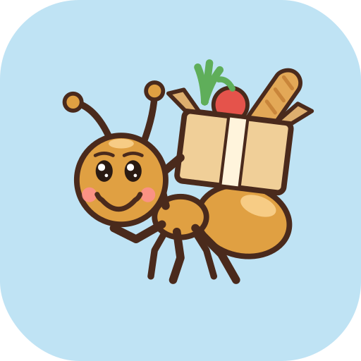
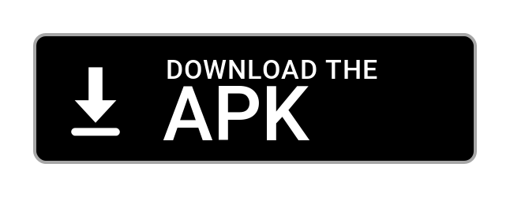
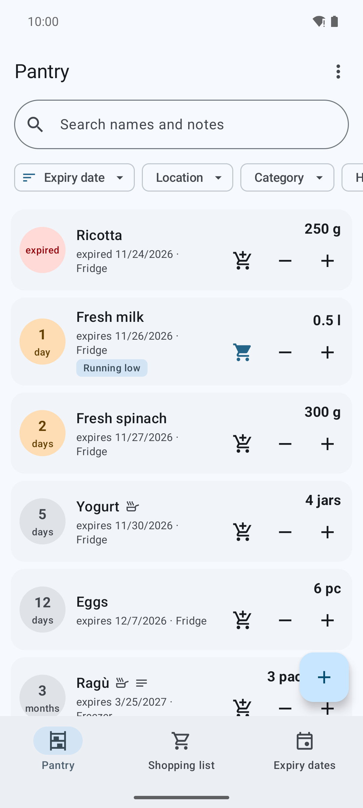
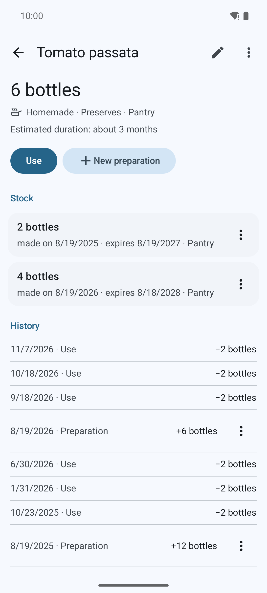
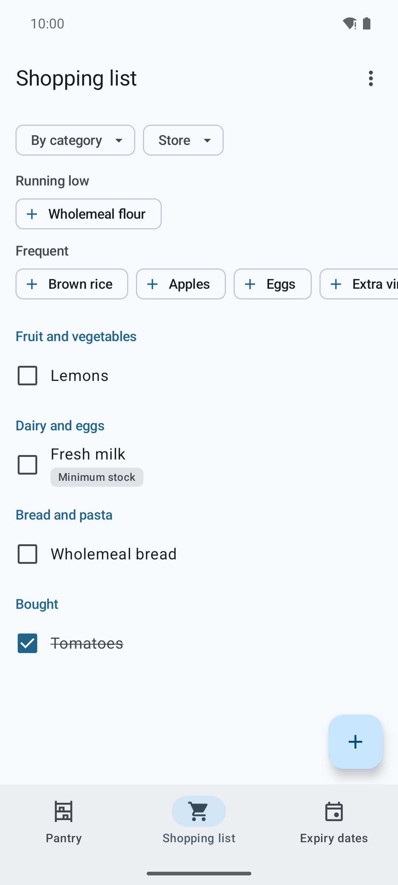
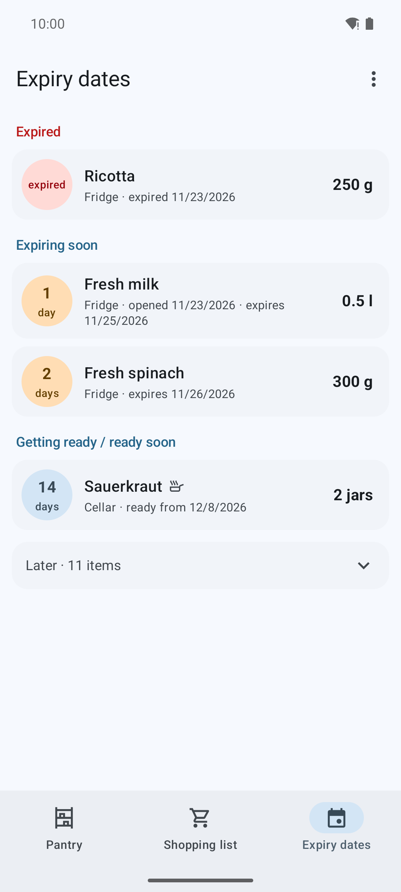
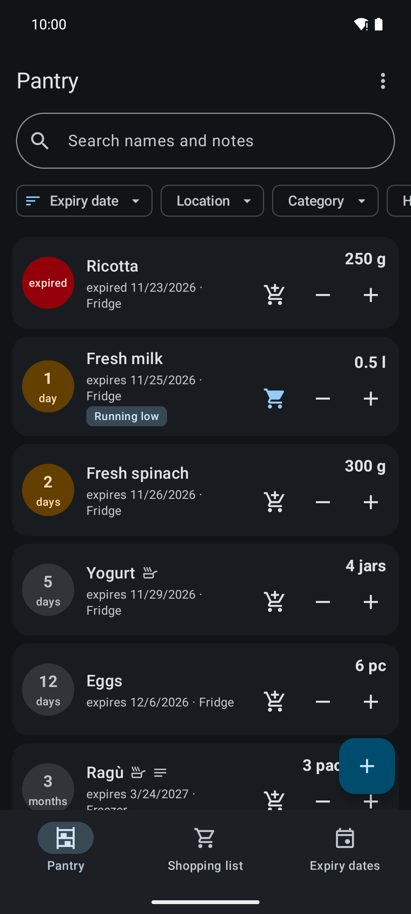
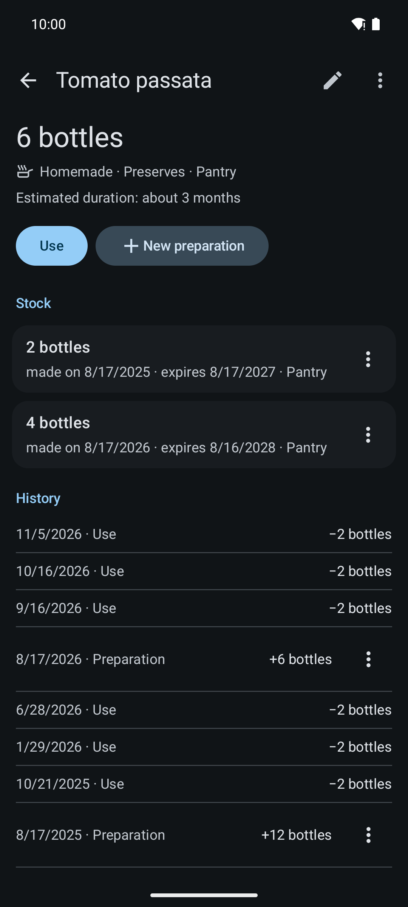
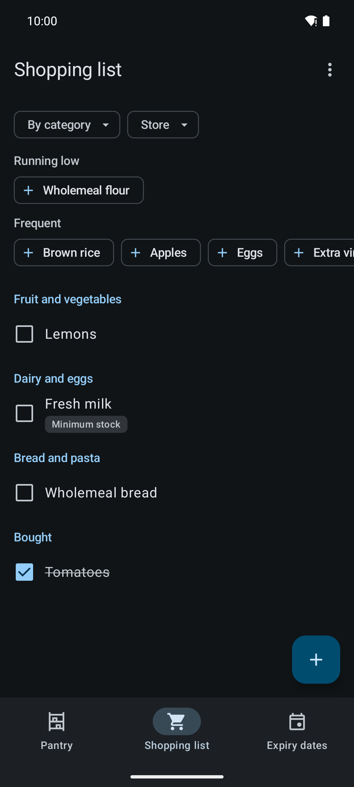
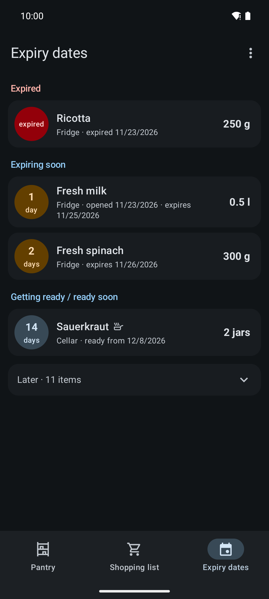

# Formica

**English** · [Italiano](README.it.md)

[](LICENSE)


[](#permissions)



**Formica** is an Android app to manage the **household pantry** and the **shopping
list**: what you have, where it is, when it expires and what to buy again. It also takes
care of homemade products and those bought from producers. It is shared with the family
by exchanging a file between phones, and it works without internet, without an account
and without a server.

**The name.** *Formica* is Latin, as well as Italian, for ant: ants are among the living
beings that keep the best pantries.

It is free software, with no internet access, no ads and no trackers, and it uses only
open-source libraries (AndroidX, Kotlin). Releases are built, signed and verified by
GitHub Actions, and the builds are designed to be reproducible.

<p align="center">
  <a href="https://apps.obtainium.imranr.dev/redirect?r=obtainium://add/https://github.com/nidamanx/formica"></a>
  
  <a href="https://github.com/nidamanx/formica/releases/latest"></a>
</p>

Signing certificate, to check with [AppVerifier](https://github.com/soupslurpr/AppVerifier)
or [Obtainium](https://github.com/ImranR98/Obtainium) ([other checks](#verifying)):

```
io.github.nidamanx.formica
5A:73:FC:B9:DB:E5:53:D0:F7:18:7F:56:04:90:4C:EC:19:DD:77:6B:AB:1B:0A:C2:8D:17:69:1D:88:B6:B3:9C
```

<p align="center">
  <a href="fastlane/metadata/android/en-US/images/phoneScreenshots/1.png"></a>
  <a href="fastlane/metadata/android/en-US/images/phoneScreenshots/2.png"></a>
  <a href="fastlane/metadata/android/en-US/images/phoneScreenshots/3.png"></a>
  <a href="fastlane/metadata/android/en-US/images/phoneScreenshots/4.png"></a>
</p>
<p align="center">
  <a href="fastlane/metadata/android/en-US/images/phoneScreenshots/5.png"></a>
  <a href="fastlane/metadata/android/en-US/images/phoneScreenshots/6.png"></a>
  <a href="fastlane/metadata/android/en-US/images/phoneScreenshots/7.png"></a>
  <a href="fastlane/metadata/android/en-US/images/phoneScreenshots/8.png"></a>
</p>

## Why

At home the pantry is run by several people: whoever does the shopping does not know
what has just run out, milk gets bought twice, the jar at the back of the fridge expires
without anyone noticing. The apps that solve this usually ask for an account, put the
data on a server and show ads.

With Formica the data stays on the phone and is shared with the family through a file,
sent for example in a chat. Changes made on several phones are merged without a server.

---

## Contents

- [Features](#features)
- [Requirements](#requirements)
- [Installation](#installation)
  - [Updating](#updating)
  - [Verifying](#verifying)
- [Usage](#usage)
- [With the family](#with-the-family)
- [Permissions](#permissions)
- [Privacy](#privacy)
- [Known limitations](#known-limitations)
- [Building from source](#building-from-source)
- [Translations](#translations)
- [Project layout](#project-layout)
- [Versioning](#versioning)
- [License and disclaimer](#license-and-disclaimer)

---

## Features

- **Pantry**: products with quantities (decimals too), units, category, location
  (fridge, freezer, pantry, cellar and any others you choose) and notes. Search in names
  and notes, filters, sorting by expiry date, name or preparation date.
- **Packs and expiry dates**: several packs of the same product with different expiry
  dates; "opened on", with the days it keeps after opening; the pack that expires first
  is used first.
- **Homemade and from producers**: preserves, yogurt, fermented food and many others,
  with the preparation date and the day they are ready; purchases in large quantities.
- **Estimated duration**: from the use of the last weeks, how long your stock will last.
- **Shopping list**: items linked to the pantry or free text, grouped by category or by
  shop. Minimum stock puts a product on the list when it falls below the amount you
  choose; at the top, the products running low and those bought often.
- **Cheapest at**: for each product, the shop and the best price, noted by hand.
- **One notification a day**, at the time you choose, with what expires and what is
  ready; none when there is nothing to report.
- **With the family**: export a file and open it on another phone, with a preview, a
  backup copy and undo (see [With the family](#with-the-family)).
- Light and dark theme following the system; works with TalkBack and with large text.
- English, Italiano, Français, Deutsch, Español.

## Requirements

- Android 8.0 (API 26) or later, on **phones and tablets**: with or without Google
  services, with the maker's original system or with alternative systems such as
  GrapheneOS, LineageOS and many others.

## Installation

**[Obtainium](https://github.com/ImranR98/Obtainium)** (updates straight from GitHub
releases): add the app with this URL

```
https://github.com/nidamanx/formica
```

**F-Droid**: coming soon.

**Manually**: download `formica-<version>.apk` from the
[latest release](https://github.com/nidamanx/formica/releases/latest) and open it on the
phone.

### Updating

Obtainium and F-Droid notify you of new versions. A manual install is updated by
installing the APK of the new release over the old one: your data is kept. Every version
is signed with the same key (see [Verifying](#verifying)).

### Verifying

Every release is built by GitHub Actions from the tagged source code. Three independent
checks are available.

**1. Signing certificate.** It is the same for every version. Compare it with
[AppVerifier](https://github.com/soupslurpr/AppVerifier) or with
[Obtainium](https://github.com/ImranR98/Obtainium).

```
io.github.nidamanx.formica
5A:73:FC:B9:DB:E5:53:D0:F7:18:7F:56:04:90:4C:EC:19:DD:77:6B:AB:1B:0A:C2:8D:17:69:1D:88:B6:B3:9C
```

**2. File checksum.** Each release includes `SHA256SUMS`:

```
sha256sum -c SHA256SUMS
```

**3. Build provenance.** A signed attestation proves the APK was produced by this
repository's release workflow from a specific commit:

```
gh attestation verify formica-<version>.apk --repo nidamanx/formica
```

Builds are designed to be reproducible: F-Droid builds the app from source on its own
servers and distributes it only if the result is identical to the APK published here.

To report a security problem, see [SECURITY.md](SECURITY.md).

## Usage

1. At the first start, choose the name of the phone (the family's other phones see it)
   and whether to get the daily notification. Locations and categories are ready; you
   can change them in Settings.
2. In the **Pantry**, tap **+** to add a product: name, quantity, unit, expiry date. The
   extra fields (shelf life, minimum stock, cheapest at…) are optional.
3. On a product's card: **−** to use some, **+** for a new purchase or a new preparation,
   the cart to put it on the list. Tap the card for the details: packs (their dates and
   shop can be changed), moves, opening, history (a purchase or a preparation entered by
   mistake can be undone there).
4. In the **Shopping list**, tick what you buy: Formica asks whether to add it to the
   pantry.
5. **Expiry dates** shows what has expired, what expires soon and what is getting ready.

## With the family

Each phone has its own data. To share it, on one phone open
**Settings → Data exchange → Export** and send the file to the other phone (in a chat,
by email, with a cable…); on the other phone, open the file with Formica.

- A **preview** shows what will change before the data is touched.
- Three modes: **Merge** (keeps the changes made on both phones), **New products only**,
  **Replace everything**.
- Changes made on several phones are merged: quantities are the sum of purchases and
  uses, duplicates with the same name are offered for merging, notes written on both
  phones are kept one after the other.
- Before every import Formica saves a **copy of the data** (the last 5), and the last
  import can be **undone**.
- The copies stay in the app's storage on this phone: uninstalling Formica deletes them.
  For a backup elsewhere, export the file with **Save to…** (to a folder or a storage
  app, such as Nextcloud and many others); to get it back, open it with Formica and
  choose **Replace everything**.

To keep the phones in step, exchange the file now and then, in both directions.

## Permissions

Formica has **no internet access** and requests only these permissions:

| Permission | Why |
|---|---|
| Notifications (`POST_NOTIFICATIONS`) | The daily notification about expiry dates and preparations that are ready. From Android 13 it is asked for, and it can be denied |
| Run at startup (`RECEIVE_BOOT_COMPLETED`) | Schedule the notification again after the phone restarts. Added by WorkManager, the Android library that schedules it |
| Prevent sleep (`WAKE_LOCK`) | Only during the daily check, once a day; it does not turn on the screen. Added by WorkManager |
| Formica's internal permission (`io.github.nidamanx.formica.DYNAMIC_RECEIVER_NOT_EXPORTED_PERMISSION`) | Stops other apps from sending messages to the internal parts of Formica and gives no access to any data. It is needed up to Android 12; later versions offer the same protection themselves and the permission stays unused. No other app can obtain it |

The build fails automatically if the APK ever requests anything else
(see `config/allowed-permissions.txt`).

## Privacy

Formica collects nothing, sends nothing, and contains no ads or analytics. Your data
stays on the phone and is **excluded from Android backups** and from transfers to a new
phone: it only leaves with an export you start. See [PRIVACY.md](PRIVACY.md).

The exported file is a plain JSON file, not encrypted: whoever receives it can read its
content. Send it only to people you choose.

Formica has **no access** to your location, contacts, camera, microphone or any other
personal data. You can check it: the source is public, and the build fails if the app
ever requests another permission.

## Known limitations

- The exchange is manual: phones do not synchronize by themselves.
- Prices in "Cheapest at" are in euros.
- A new purchase with the same expiry date and location as a pack already in the pantry,
  not opened yet, is added to that pack, which keeps the date and shop of the first
  purchase.
- The daily notification may arrive a few minutes late: Android groups background work
  to save battery.
- On tablets the interface is the phone one, stretched to the whole screen.

## Building from source

Requirements: JDK 17 and the Android SDK.

```
./gradlew test lintRelease assembleRelease
```

The result is an unsigned APK in `app/build/outputs/apk/release/`. Notes for maintainers
in [docs/MAINTAINING.md](docs/MAINTAINING.md).

## Translations

App texts are in `app/src/main/res/values-*/strings.xml`, store texts in
`fastlane/metadata/android/*/`. Corrections are welcome.

## Project layout

```
formica/
├── app/        the app (Kotlin, Jetpack Compose, Room) and its tests
├── art/        icon, store banner, social preview and install badges
├── config/     the only permissions the APK may request
├── docs/       notes for maintainers
├── fastlane/   store texts and screenshots per language, changelogs in English
├── fdroid/     draft of the F-Droid build recipe
├── keystore/   signing certificate fingerprints
├── scripts/    scripts used by the automated checks
└── .github/    GitHub Actions workflows
```

## Versioning

The project follows [Semantic Versioning](https://semver.org/). The version
(`versionName`, and `versionCode` for Android) is in `app/build.gradle.kts` and is shown
in About, in the ⋮ menu. Every release has a Git tag `vX.Y.Z`, and the changes of each version
are listed in [CHANGELOG.md](CHANGELOG.md).

## License and disclaimer

Copyright (C) 2026 Nicola Davide Mannarelli ([@nidamanx](https://github.com/nidamanx))

This program is free software: you can redistribute it and/or modify it under the terms
of the **GNU Affero General Public License** as published by the Free Software
Foundation, either version 3 of the License, or (at your option) any later version
(`SPDX-License-Identifier: AGPL-3.0-or-later`). See the [LICENSE](LICENSE) file.

Some icons come from [Material Symbols](https://github.com/google/material-design-icons)
by Google, under the Apache License 2.0.

**Credit.** If you use this app, or parts of its code, in your work or in another
project, please credit *Formica* by Nicola Davide Mannarelli and link to this repository.
The **Cite this repository** button on GitHub, generated from
[CITATION.cff](CITATION.cff), gives a ready-made citation. The license already requires
redistributed and modified copies to keep the copyright notice.

**Disclaimer.** This software is provided "as is", without warranty of any kind, express
or implied. In no event shall the author be liable for any claim, damages or other
liability arising from the use or misuse of this software, including expired food,
missed reminders or lost data. The expiry dates shown are the ones you enter: always
check the state of food before eating it.
